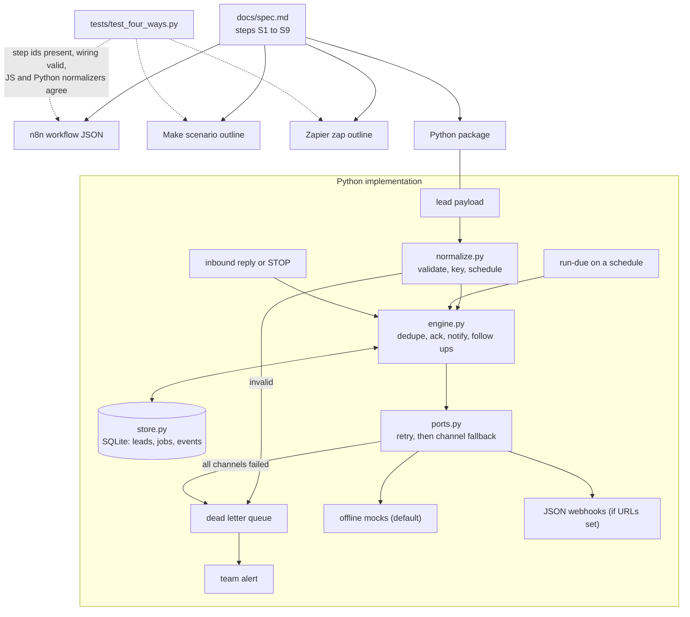

# same-automation-four-ways

**Problem:** a new lead who hears nothing for a day usually hires someone else, and a follow up that arrives after they already replied, or at 2 a.m., is worse than none.

**For:** an owner or operations lead at a small service business who is choosing between n8n, Make, Zapier and custom code, and wants to see how each one behaves when a send fails before committing to it.

**What it does:** every new lead gets an answer straight away, the team is told, and follow ups go out on days 1, 3 and 7 during daytime hours. The sequence stops the moment the lead replies, books or opts out. A failed text falls back to email, and a lead nobody can reach is flagged to a person and never dropped silently.

**What is in the repo:** that one automation written down once ([`docs/spec.md`](docs/spec.md)) and built four ways, plus a comparison of the four on failure handling, upkeep and cost ([`docs/comparison.md`](docs/comparison.md)).

**What is proven and what is not:** the Python version runs and has 82 offline tests. The n8n workflow is generated and checked by tests but has never been imported into n8n. The Make and Zapier versions are written outlines. Nothing here has sent a real text or email: every provider is a mock. Details under [Limitations](#limitations).

## What you will see

`python demo/run_demo.py` plays eleven simulated days in under a second, with no keys and no network. These lines are copied from the real output ([`demo/output.txt`](demo/output.txt), which a test compares with what the demo prints):

```
Mon 01-05 11:00  phone:+15555550101    duplicate          source=ad form
Mon 01-05 13:00  phone:+15555550104    send_failed        ack via sms: sms to +15555550104 rejected by provider
Mon 01-05 13:00  phone:+15555550104    sent               ack via email
Mon 01-05 14:00  phone:+15555550105    unreachable        all channels failed, sequence stopped
Mon 01-05 23:30  phone:+15555550106    retry              ack sms: attempt 1 failed (sms provider timeout), waiting 2s
Tue 01-06 17:00  phone:+15555550107    opted_out          cancelled 3 pending steps
Tue 01-06 21:00  phone:+15555550102    replied            cancelled 3 pending steps
Wed 01-07 08:00  phone:+15555550106    sent               follow_up_1 via sms

Blake Example   replied             follow_up_1=done, follow_up_2=cancelled, follow_up_3=cancelled, close=cancelled
Emery Test      unreachable         none scheduled

messages sent: 16 (email 4, sms 12)
dead letters: 2
```

Read top to bottom: a duplicate submission starts nothing, a rejected text falls back to email, a lead with no working channel stops cleanly, a timeout is retried, a STOP and a reply each cancel the three steps still pending, and a lead that arrived at 23:30 gets its first follow up at 08:00.

## The four builds

| Way | File | State |
| --- | --- | --- |
| n8n | [`n8n/lead_follow_up.workflow.json`](n8n/lead_follow_up.workflow.json) | Workflow JSON, 39 nodes, generated by `n8n/build_workflow.py`. Checked by tests, not yet imported into n8n |
| Make | [`make/scenario-outline.md`](make/scenario-outline.md) | Written outline: two scenarios and a data store, module by module. Not built in an account |
| Zapier | [`zapier/zap-outline.md`](zapier/zap-outline.md) | Written outline: one Zap with Paths, step by step. Not built in an account |
| Python | [`src/lead_followup/`](src/lead_followup/) | Working package, standard library only, 82 tests |

The automation in full: take a lead from a webhook, validate and normalize it, drop duplicates, upsert the CRM, acknowledge at once, tell the team, send follow ups on days 1, 3 and 7 inside a local send window, stop when the lead replies, books or opts out, and close the lead on day 10. Sends retry with backoff, fall back from SMS to email, and land in a dead letter queue with a team alert when every channel fails.

Cost figures in the comparison are labelled assumptions with the formula shown. None is a quoted vendor price.

## Architecture



## Run it

Python 3.10 or newer. No dependencies, no keys, no network.

```bash
python demo/run_demo.py
```

That is the whole demo: eleven simulated days, eight submissions, two replies.

To use the package directly:

```bash
pip install -e .
python -m lead_followup lead '{"name": "Alex Sample", "phone": "555-555-0101", "service": "gutter cleaning"}'
python -m lead_followup run-due
python -m lead_followup reply 555-555-0101 "STOP"
```

Those print `accepted: sequence scheduled`, `0 due steps handled` (the first follow up is a day away) and `opted_out`. The quoting is for bash. In PowerShell, put the JSON in a variable and escape the inner quotes.

`run-due` is the command to put on a schedule (cron or a task scheduler, every few minutes). State lives in the SQLite file named by `DB_PATH` (default `leads.db` in the current folder). Copy `.env.example` for the settings. With no webhook URLs set, every outbound call goes to an offline mock.

## Tests

```bash
pip install -r requirements-dev.txt
python -m pytest -q
```

82 tests, about a second, fully offline. They cover the Python engine (happy path, duplicates, replies, opt out, retry, fallback, dead letters, restart, send window, catching up after scheduler downtime) and also hold the other three implementations to the spec:

- every spec step id (S1 to S9) appears in the n8n workflow, the Make outline, the Zapier outline and the engine
- the n8n JSON matches its generator, has no orphan nodes, retries every outbound call, and puts a wait and a status check in front of every follow up
- the n8n Code node is executed under Node.js on the same payloads as the Python normalizer and must agree on every field and due time (skipped if Node.js is not installed)
- the unit counts used by the cost model match the counts written in the outlines
- `demo/output.txt` is exactly what the demo prints today

CI (`.github/workflows/ci.yml`) runs the tests and the demo on Python 3.10 and 3.12.

## Demo

`python demo/run_demo.py` drives the engine with a fake clock, mock providers and synthetic leads from `demo/sample_leads.json`. The full captured run, ending with the cost model table, is in [`demo/output.txt`](demo/output.txt).

To regenerate the saved output: `python demo/run_demo.py --save`. To regenerate the n8n workflow after editing the builder or `normalize_lead.js`: `python n8n/build_workflow.py`.

## Where this pattern runs

The pattern is drawn from systems that run two small service companies day to day: a lead arrives from a form or an ad, gets an answer right away, and is followed up on a fixed cadence until a person takes over. The rules that matter there are the ones this repo spends its tests on: never follow up with someone who already answered, never send a follow up at night (the first acknowledgement is the one message that goes out at any hour, because the lead has just written in), and never let a failed send disappear without telling a person. Nothing here is copied from those systems. The code, data and wording were written new for this repo and all sample data is synthetic.

## Limitations

What has never touched a live service:

- **No message has been sent.** There is no SMS, email or CRM vendor integration. Outbound calls are either in-memory mocks (the default, and all the demo and tests use) or a generic JSON POST to a URL you set. That webhook adapter is tested with a fake opener, never against a real endpoint.
- **The n8n workflow has not been imported into n8n.** Tests check its wiring, retries and step coverage, and run its Code node under Node.js against the Python normalizer. Node type versions and the credential placeholder may still need adjusting on import. Nodes sit on a plain grid, not a tidy canvas.
- **The Make and Zapier files are outlines**, written from product knowledge and not built in an account. Module names, plan requirements and metering rules should be checked against the current products.
- **Cost figures are assumptions.** The fees, allowances and overage rates in `cost_assumptions.json` are placeholders. Only the unit counts are derived, and those come from this repo's own designs and stated metering assumptions.
- **No load, volume or delivery numbers exist.** The only timing measured is the test suite and the demo.

What the Python version does not do:

- **No inbound web server.** It exposes functions and a CLI. Receiving the webhook and the reply callback over HTTP is left to whatever framework you already run, and so is authenticating them.
- **Time handling is a fixed UTC offset.** No daylight saving, no per lead timezone, no weekend or holiday rules.
- **The acknowledgement ignores the send window.** A lead that writes in at 23:30 gets its acknowledgement at 23:30. Only follow ups wait for 08:00.
- **Dedupe is by one key.** A lead who submits once with a phone and again with only an email is treated as two leads.
- **An opt out lasts until the dedupe window ends.** A reply after STOP cannot undo it, but the same contact submitting the form again after 30 days starts a new sequence. There is no permanent suppression list.
- **Opt out matching is exact words.** `STOP`, `Stop.` and `stop!` opt out. "please stop texting me" is treated as a normal reply: follow ups still stop, but the status is `replied` and the team is told.
- **At most once sends.** A job is claimed before it is sent, so a crash mid send leaves it in `running` for a person to review. It is never retried automatically.
- **Single process.** SQLite and no locking beyond what SQLite gives. One scheduler, not a fleet.
- **A permanent SMS failure is not remembered.** The next follow up tries SMS again before falling back to email.
- **Catch up rules exist only in Python.** After scheduler downtime the Python engine sends only the newest overdue follow up and holds it until the send window. The n8n workflow and the two outlines plan send times up front and do not re-check them.

License: MIT, see the LICENSE file.
