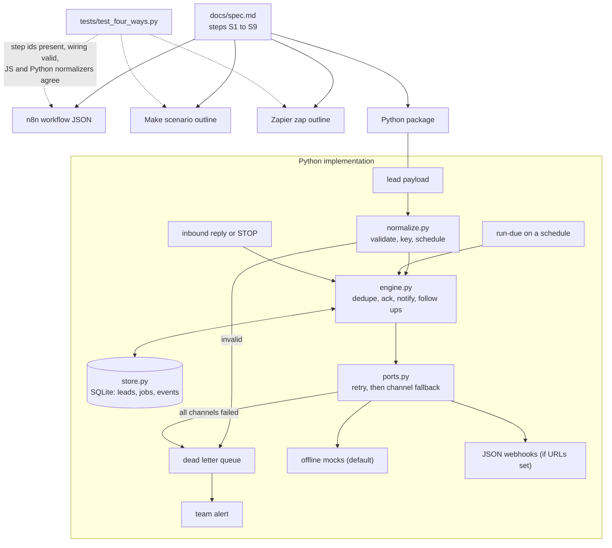

# same-automation-four-ways

A new lead that hears nothing for a day usually hires someone else, and a follow up that fires after they already replied is worse than none.
Most teams pick a tool for this before they know how it behaves when a send fails, so this repo builds one spec four ways and compares them.

## What it does

One lead follow up automation, written down once in [`docs/spec.md`](docs/spec.md) and implemented as:

| Way | File | State |
| --- | --- | --- |
| n8n | [`n8n/lead_follow_up.workflow.json`](n8n/lead_follow_up.workflow.json) | Importable workflow JSON, 39 nodes, generated by `n8n/build_workflow.py` |
| Make | [`make/scenario-outline.md`](make/scenario-outline.md) | Module by module outline of two scenarios and a data store |
| Zapier | [`zapier/zap-outline.md`](zapier/zap-outline.md) | Step by step outline of one Zap with Paths |
| Python | [`src/lead_followup/`](src/lead_followup/) | Working package, standard library only, 76 tests |

The automation: take a lead from a webhook, validate and normalize it, drop duplicates, upsert the CRM, acknowledge at once, tell the team, send follow ups on days 1, 3 and 7 inside a local send window, stop the moment the lead replies, books or opts out, and close the lead on day 10. Sends retry with backoff, fall back from SMS to email, and land in a dead letter queue with a team alert when every channel fails.

The comparison on failure handling, maintainability and cost is in [`docs/comparison.md`](docs/comparison.md). Cost figures there are labelled assumptions with the formula shown. None is a quoted vendor price.

## Architecture



## Run it

Python 3.10 or newer. No dependencies, no keys, no network.

```bash
python demo/run_demo.py
```

That is the whole thing: eleven simulated days, eight submissions, every branch of the spec.

To use the package directly:

```bash
pip install -e .
python -m lead_followup lead '{"name": "Alex Sample", "phone": "555-555-0101", "service": "gutter cleaning"}'
python -m lead_followup run-due
```

`run-due` is the command to put on a schedule (cron or a task scheduler, every few minutes). State lives in the SQLite file named by `DB_PATH`. Copy `.env.example` for the settings. With no webhook URLs set, every outbound call goes to an offline mock.

## Tests

```bash
pip install -r requirements-dev.txt
python -m pytest -q
```

76 tests, under two seconds, fully offline. They cover the Python engine (happy path, duplicates, replies, opt out, retry, fallback, dead letters, restart, send window) and also hold the other three implementations to the spec:

- every spec step id (S1 to S9) appears in the n8n workflow, the Make outline, the Zapier outline and the engine
- the n8n JSON matches its generator, has no orphan nodes, retries every outbound call, and puts a wait and a status check in front of every follow up
- the n8n Code node is executed under Node.js on the same payloads as the Python normalizer and must agree on every field and due time (skipped if Node.js is not installed)
- the unit counts used by the cost model match the counts written in the outlines
- `demo/output.txt` is exactly what the demo prints today

CI (`.github/workflows/ci.yml`) runs the same on Python 3.10 and 3.12.

## Demo

`python demo/run_demo.py` drives the engine with a fake clock and synthetic leads from `demo/sample_leads.json`. The captured run is in [`demo/output.txt`](demo/output.txt). An excerpt:

```
Mon 01-05 13:00  phone:+15555550104    send_failed        ack via sms: sms to +15555550104 rejected by provider
Mon 01-05 13:00  phone:+15555550104    sent               ack via email
Mon 01-05 14:00  phone:+15555550105    unreachable        all channels failed, sequence stopped
Mon 01-05 23:30  phone:+15555550106    retry              ack sms: attempt 1 failed (sms provider timeout), waiting 2s
Tue 01-06 21:00  phone:+15555550102    replied            cancelled 3 pending steps
Wed 01-07 08:00  phone:+15555550106    sent               follow_up_1 via sms
```

What to look for: a duplicate that starts nothing, a rejected payload in the dead letter queue, an SMS failure that falls back to email, a lead with no working channel that stops cleanly, a reply and a STOP that each cancel three pending steps, and a 23:30 lead whose follow ups all land at 08:00. The run ends with the cost model table.

To regenerate the saved output: `python demo/run_demo.py --save`. To regenerate the n8n workflow after editing the builder or `normalize_lead.js`: `python n8n/build_workflow.py`.

## Where this pattern runs

The pattern is drawn from systems that run two small service companies day to day: a lead arrives from a form or an ad, gets an answer in seconds, and is followed up on a fixed cadence until a person takes over. The rules that matter there are the ones this repo spends its tests on: never message someone who already answered, never message at night, and never let a failed send disappear without telling a person. Nothing here is copied from those systems. The code, data and wording were written new for this repo and all sample data is synthetic.

## Limitations

- **Only the Python version was run.** The n8n workflow is validated structurally and its Code node is executed in a test, but the workflow has not been imported into a live n8n instance, so node type versions and the credential placeholder may need adjusting on import. Nodes are placed on a plain grid, not a tidy canvas.
- **The Make and Zapier files are outlines**, written from product knowledge and not built in an account. Module names, plan requirements and metering rules should be checked against the current products.
- **Cost figures are assumptions.** The fees, allowances and overage rates in `cost_assumptions.json` are placeholders. Only the unit counts are derived, and those come from this repo's own designs and stated metering assumptions.
- **No inbound web server.** The Python package exposes functions and a CLI. Receiving the webhook and the reply callback over HTTP is left to whatever framework you already run.
- **No real provider adapters.** Outbound calls are generic JSON webhooks. There is no SMS, email or CRM vendor integration, and the webhook adapters are tested with a fake opener, not against a live endpoint.
- **Time handling is a fixed UTC offset.** No daylight saving, no per lead timezone, no weekend or holiday rules.
- **Dedupe is by one key.** A lead who submits once with a phone and again with only an email is treated as two leads.
- **At most once sends.** A job is claimed before it is sent, so a crash mid send leaves it in `running` for a person to review. It is never retried automatically.
- **Single process.** SQLite and no locking beyond what SQLite gives. One scheduler, not a fleet.
- **A permanent SMS failure is not remembered.** The next follow up tries SMS again before falling back to email.

License: MIT, see the LICENSE file.
